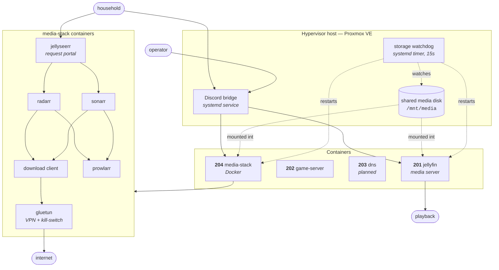
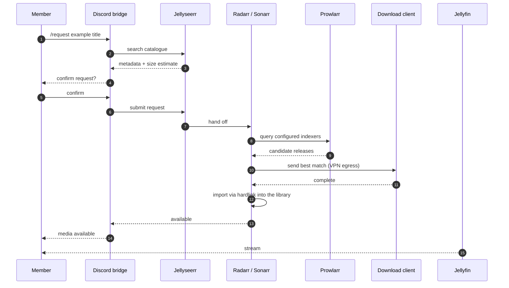
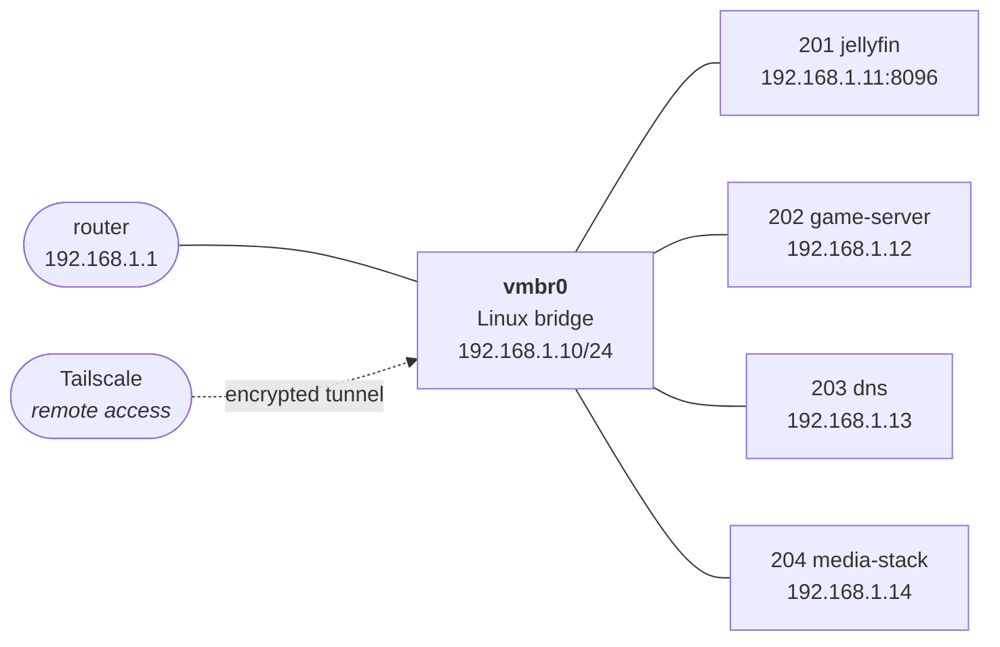

# Homelab

A single-node Proxmox homelab running a media server, automated storage watchdog, download pipeline, and Discord SRE operations agent grounded on this repository.

Configuration templates and documentation use generic placeholders.

Start here: [Setup Guide](docs/setup/01-proxmox-host.md).

---

## System Overview

- **Automated storage recovery:** The library resides on external storage. If the mount drops, running containers could write into the host's root filesystem. A systemd watchdog detects drops every 15 seconds, stops dependent containers, remounts storage, and restarts services. See [Storage Watchdog](docs/admin_storage_watchdog.md).
- **Discord media requests:** Private user channels provide `/request` and `/status` commands with release size estimates and progress updates, isolating household members from direct infrastructure access.
- **Discord operations agent:** An SRE agent in the ops channel executes administrative tasks and troubleshooting commands via hypervisor CLI, grounded on documentation in this repository.

---

## Architecture

### Request flow

### Network

Remote access is Tailscale-only — nothing is port-forwarded to the internet.
The tailnet ACL grants members exactly two destinations, the media server and
the request portal, and nothing else. See
[docs/admin_tailscale_network.md](docs/admin_tailscale_network.md).

---

## Hardware Requirements

| Component | Specification |
| :--- | :--- |
| Host | x86-64 system with virtualization support (Intel VT-x / AMD-V) |
| CPU | 4+ threads; Intel iGPU recommended for hardware transcoding |
| RAM | 16 GB |
| System disk | 500 GB SSD for hypervisor and container root filesystems |
| Media disk | Dedicated external or internal storage formatted as ext4 |
| Hypervisor | Proxmox VE 9.x |

---

## Repository Structure

| Path | Contents |
| :--- | :--- |
| [docs/setup/](docs/setup/01-proxmox-host.md) | Step-by-step setup guides |
| [docs/](docs/index.md) | Operational runbooks and troubleshooting guides |
| [docs/architecture.md](docs/architecture.md) | Topology, network scheme, and architecture reference |
| [scripts/](scripts/README.md) | Media stack CLI, Discord bridge, and storage watchdog scripts |
| [config/](config/README.md) | Compose, systemd, ACL, and container configuration templates |
| [AGENTS.md](AGENTS.md) | Grounding contract for the SRE agent |

Application state (`/opt/appdata/`) is untracked; the repository stores configuration templates and documentation.

---

## Critical Requirements

- **Path parity:** All media services must mount the same host directory at the same in-container path (`${MEDIA_ROOT}:/media`). If paths diverge, file imports fall back to copying instead of hardlinking, doubling disk usage, or fail completely.
- **`nofail` mount option:** External storage must be mounted with `nofail` in `/etc/fstab` so the host boots cleanly if the drive is disconnected or slow to initialize.

---

## Compliance and Scope

This repository provides infrastructure templates and runbooks for private media management. No external indexers, feeds, or media assets are configured or distributed. Operators are responsible for configuring authorized services in compliance with applicable licenses.

## License

[MIT](LICENSE).
