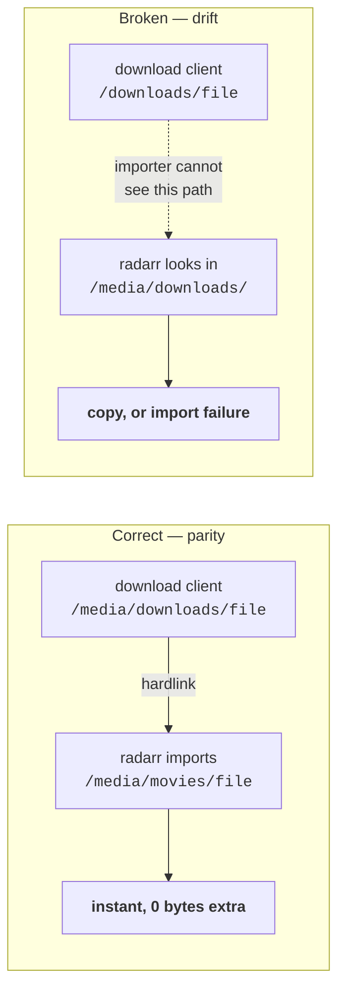

# Application Path and Quality Baseline

Required in-application path configurations and quality limit specifications.

## Path Parity Baseline

> **Requirement:** All media services must mount the same host directory at the same in-container path (`${MEDIA_ROOT}:/media`). See [Path Parity](#path-parity) below.

Required in-application path settings:

| Application | Setting | Value |
| :--- | :--- | :--- |
| Download client | Default save path | `/media/downloads` |
| Radarr | Root folder | `/media/movies` |
| Sonarr | Root folder | `/media/tv` |

**Configuration rules:**

- Remove legacy root folders pointing elsewhere (`/data`, `/downloads`, `/media/data`).
- Maintain a single mapping per content type.
- Completed downloads land under `/media/downloads` to allow hardlinking into `/media/movies` and `/media/tv`.

### Path Parity

Hardlinking requires the source and destination to reside on the same filesystem and be addressed by the same path from the importing process.



If paths diverge, imports fall back to file copying (doubling disk space usage) or fail with "no files found are eligible for import" errors.

### Verification

From inside the media-stack container:

```bash
docker exec downloader ls -la /media
docker exec radarr     ls -la /media
docker exec sonarr     ls -la /media
```

All three must list the same directories. If paths differ, correct the Docker Compose volume definitions before altering in-application settings.

## Quality Definitions

Quality limits are specified in MB per minute (**Settings → Quality**) and scale dynamically by media runtime. Radarr scales by total film duration; Sonarr scales by episode runtime and episode count.

| Tier | Max MB/min | A 2-hour film | A 22-min episode |
| :--- | ---: | ---: | ---: |
| SD / 480p | 15 | ~1.8 GB | ~0.3 GB |
| 720p | 35 | ~4.2 GB | ~0.8 GB |
| 1080p (WEB / HDTV / Bluray) | 75 | ~9 GB | ~1.7 GB |
| 1080p Remux | 250 | ~30 GB | ~5.5 GB |
| 2160p (WEB / HDTV / Bluray) | 185 | ~22 GB | ~4 GB |
| 2160p Remux | 800 | ~96 GB | ~17.6 GB |

Verify expected release sizes against runtime and tier maximums before modifying configuration.

## Deprioritizing Remuxes

Configuration to prioritize standard encodes over large remux releases:

**1. A custom format.** Named `Remux`, matching:

```
(?i)\bRemux\b
```

Case-insensitive with word boundaries, so it matches naming conventions without
false positives on titles containing the substring.

**2. Scoring.** In each active quality profile:

- Assign `Remux` custom format a score of **`-50`**.
- Set **Minimum Custom Format Score** to **`-50`**.

This allows remux releases to be downloaded if no alternative exists, while ensuring releases scoring `0` or higher take precedence.

**3. Quality tier ordering.** Quality tiers are evaluated prior to custom format scores. Move `Remux-1080p` below standard releases:

1. `Bluray-1080p`
2. `WEB 1080p`
3. `Remux-1080p` (deprioritized)

## Troubleshooting

### "No files found are eligible for import" at 100%

**Symptom.** The download client reports complete. Radarr or Sonarr shows a
warning icon and refuses to import.

**Cause.** Path drift. The download client wrote to a path only it can see.
The two containers are not sharing a directory, so the importer has no
visibility into the finished file.

**Fix.** Diff the live compose file against the template:

```bash
diff -u /opt/appdata/docker-compose.yml \
        /opt/homelab/config/templates/docker/media-stack.compose.yml
```

Any volume line in the live file that is not in the template represents configuration drift.
Correct it so every media service maps `${MEDIA_ROOT}:/media`, then recreate:

```bash
cd /opt/appdata && docker compose down && docker compose up -d
```

### Indexers stuck unavailable after a VPN reconnect

**Symptom.** Persistent warnings that survive connectivity being restored:

```text
Indexers unavailable due to failures for more than 6 hours: <your-indexer> (Prowlarr)
```

**Cause.** When calls fail through a locked VPN firewall for long enough, the
applications mark indexers dead and enforce a multi-hour backoff. This is
common after a VPN tunnel drop, where the kill-switch correctly blocks all
outbound traffic until the tunnel re-establishes.

**Fix.** The backoff does not clear on its own once connectivity returns. Force
revalidation:

```bash
python3 /opt/homelab/scripts/arr_cli.py prowlarr test-all
```

Or in the UI: Prowlarr → Indexers → **Test All**. Either clears the lockout
immediately across the stack, instead of waiting out the timer.
