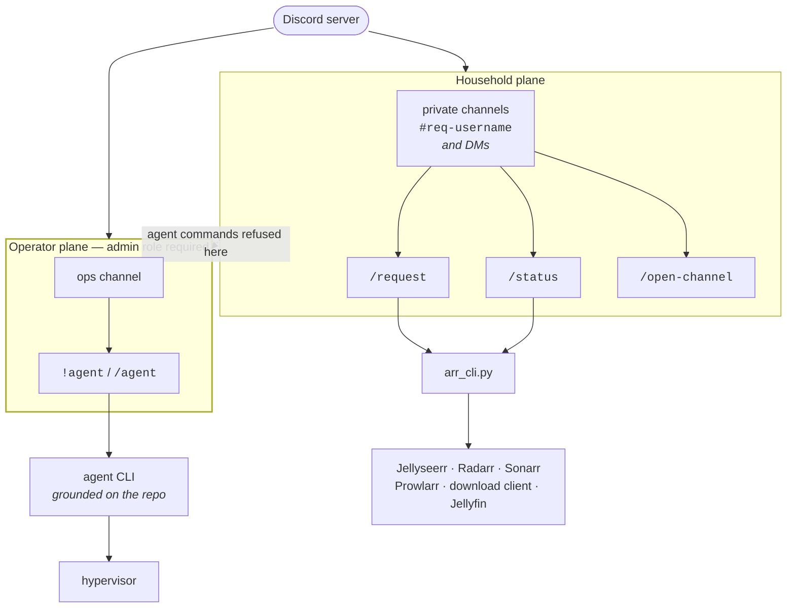

# Discord Bridge and SRE Agent

Architecture and operational runbook for [`scripts/discord_bridge.py`](../scripts/discord_bridge.py), running as a systemd service on the hypervisor host.

Setup instructions: [setup/10-discord-agent.md](setup/10-discord-agent.md).

> **Security notice:** The bridge runs with host-level privileges and invokes an agent CLI with automated execution. Access must be strictly restricted to trusted administrative Discord roles.
> Credentials reside in `/etc/homelab/homelab.env` (mode `0600`) and are untracked in version control.

## System Architecture



Plane separation is strictly enforced: agent commands are rejected in household channels, and household interactions respond ephemerally to avoid leaking infrastructure details.

## Household Plane

### `/open-channel`

Provisions a private `#req-<username>` channel under the media requests category. `@everyone` view and send permissions are denied; only the requesting user, the bot, and administrators have access. A pinned onboarding message provides usage instructions.

### Auto-Provisioning on Join

`on_member_join` automatically creates the private request channel for new guild members and sends a welcome direct message.

### `/request <title>`

Performs catalogue search and gates download behind user confirmation. All responses are ephemeral.

**Query parsing:** Resolution tags (`4k`, `1080p`, `720p`, `uhd`, `hdr`, `remux`, `bluray`, `web-dl`), media-type hints, and season tokens (`season 2`, `s02`) are extracted from free-text queries to determine intent while keeping catalogue searches clean.

**Ranking:** Results are scored by popularity, vote count, title match, and release year.

**Type scoping:** Film queries return movie releases; TV queries return series and season selections.

**Release sizing:** Provides initial runtime-based size estimates. `🔍 Interactive Release Search` queries Prowlarr on demand (40s timeout) to aggregate real indexer releases by quality tier:

```text
• 2160p 4K UHD:  min – max GB   (avg X GB, N results)
• 1080p FHD:     min – max GB   (avg X GB, N results)
• 720p HD:       min – max GB   (avg X GB, N results)
```

No download is queued until the user clicks `✅ Confirm Download`.

### `/status`

Displays ephemeral real-time queue progress bars, ETAs, and active downloads. Completed and declined items are excluded.

`🔍 See Details` displays pipeline tracking:

```text
[Portal] ➔ [Radarr/Sonarr] ➔ [Download] ➔ [Import] ➔ [Media server]
```

with transfer speed, peer counts, ETA, target path, and streaming URL.

## Operator Plane

### Lifecycle of an `!agent` Run

1. Operator sends `!agent <prompt>` or `/agent prompt:<prompt>` in the ops channel.
2. Bridge verifies admin role permissions.
3. **FIFO execution queue:** Active runs serialize execution. New requests are queued to prevent concurrent host state modifications.
4. Discord typing heartbeat maintained during execution.
5. `git fetch --all && git pull --rebase` executed on `/opt/homelab` to ensure documentation currency.
6. Invokes `$AGENT_CLI_BIN $AGENT_CLI_ARGS "<prompt>"`.
7. Session state preserved within thread or 15-minute window via `$AGENT_CLI_CONTINUE_FLAG`.
8. Secret scrubber strips API keys, tokens, and WireGuard private keys from CLI output.
9. Output chunked to 1900 characters preserving markdown code blocks.

Reset context with `!agent reset` or `!agent new`.

### Agent CLI Configuration

Configurable via environment variables in `/etc/homelab/homelab.env`:

```bash
AGENT_CLI_BIN=/usr/local/bin/<your-agent-cli>
AGENT_CLI_ARGS=--add-dir /opt/homelab --print
AGENT_CLI_CONTINUE_FLAG=--continue
```

The bridge shells out with the user prompt as the final positional argument.

### Secret Scrubbing

Two-layer filtering applied prior to Discord message transmission:

- **Known values:** Exact matching against values defined in `/etc/homelab/homelab.env`.
- **Pattern matching:** Regex scanning for bot tokens, private keys, authentication headers, and password hashes.

In addition, [AGENTS.md](../AGENTS.md) instructs the agent never to output secrets.

### Real-Time Alerts

Subscribes to ntfy JSON stream and mirrors request and grab events into the ops channel as embeds.

### Autonomous Queue Watchdog

The bot periodically monitors queue health and storage thresholds. If queue items stall, auto-remediation triggers to blocklist failed releases and retry. Low disk space alerts are broadcast to the ops channel.

## Service management

```bash
systemctl status homelab-bot.service
systemctl restart homelab-bot.service        # after editing the script
journalctl -u homelab-bot.service -n 50 --no-pager
journalctl -u homelab-bot.service -f         # follow
systemctl is-enabled homelab-bot.service     # confirm it survives a reboot
```

## Required bot permissions

Either grant the bot's role **Administrator**, or these specifically:

- Manage Channels — provisioning request channels
- Manage Roles — setting per-channel permission overwrites
- View Channels, Send Messages
- Manage Messages — pinning the onboarding guide
- Explicit allow on the media requests category

## Troubleshooting

**Bot will not start.** It reports exactly which variables are missing and where
to find each one. Check `journalctl -u homelab-bot -n 30`.

**`403 Forbidden (50013)` or `(50001)` on channel creation.** Missing
permissions or missing access to the category. See the permissions list above.
Role position matters too — the bot's role must sit above the roles it manages.

**Agent runs time out.** Default cap is `AGENT_TIMEOUT_SECONDS=240`. If runs
legitimately need longer, raise it; if they are looping, narrow the prompt.
Discord's own interaction timeouts constrain how far this can go.

**Agent answers with stale information.** It reads the workspace clone. Confirm
the pull is succeeding: `cd /opt/homelab && git status`. A dirty working tree
blocks `git pull --rebase`, which is why `AGENTS.md` forbids uncommitted
host-side edits.

**Slash commands do not appear.** Guild command sync is near-instant; global
sync takes up to an hour. Confirm `DISCORD_GUILD_ID` is set — without it,
commands register globally.
