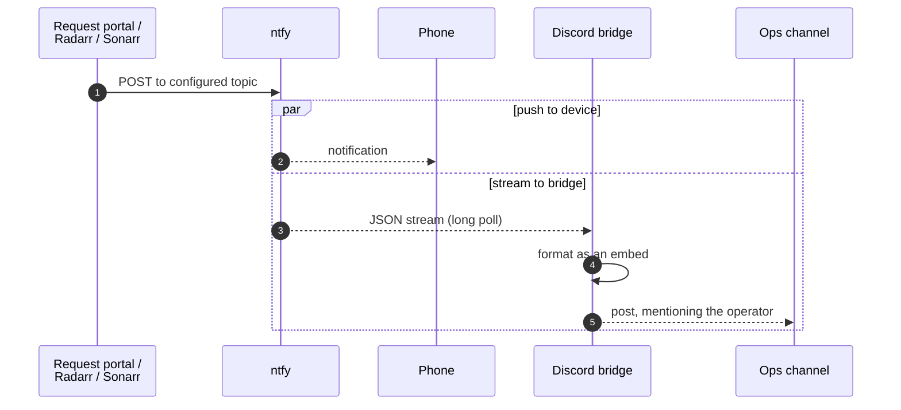

# Push Notifications Reference

## Overview

The stack pushes alerts via [ntfy](https://ntfy.sh), an HTTP-based publish-subscribe notification service. Services publish events directly to a configured topic, and the Discord bridge subscribes to mirror alerts into the ops channel.



> **Security notice:** Public ntfy topics do not require authentication; access is restricted solely by topic entropy. Generate a cryptographically random topic name (`openssl rand -hex 12`) and store it exclusively in `/etc/homelab/homelab.env`.

## Request Portal Configuration

Configure in Jellyseerr under **Settings → Notifications → ntfy.sh**:

| Field | Value |
| :--- | :--- |
| Server URL | `https://ntfy.sh` (or self-hosted URL) |
| Topic | Configured topic string |

Triggers:
- Request Automatically Approved
- Request Pending Approval *(optional; omit if auto-approval is enabled)*

## Radarr and Sonarr Configuration

Configure in Radarr and Sonarr under **Settings → Connect → + → ntfy**:

| Field | Value |
| :--- | :--- |
| Trigger | On Grab |
| Server URL | `https://ntfy.sh` |
| Topic | Configured topic string |
| Click Action URL | `http://192.168.1.14:8080` |

> **Note:** Radarr and Sonarr ntfy integrations send fixed templates that omit download size. The click action URL directs to the download client web UI to view active transfer metrics.

## Example notification

What a grab alert and a request alert look like on arrival:

```text
┌──────────────────────────────────────────────┐
│ Radarr — Movie Grabbed              6:42 PM  │
│ Example Title (2024) [1080p]                 │
├──────────────────────────────────────────────┤
│ Request Automatically Approved      6:42 PM  │
│ Example Title (2024)                         │
│                                              │
│ Requested By: <member>                       │
│ Request Status: Processing                   │
└──────────────────────────────────────────────┘
```

## Self-hosting ntfy

The compose stack includes an ntfy container. Self-hosting keeps notification
metadata off a third-party server; the tradeoff is that iOS push requires
handing instant notifications upstream anyway.

> **`NTFY_BASE_URL` and `NTFY_UPSTREAM_BASE_URL` must be set together.** If
> `NTFY_UPSTREAM_BASE_URL` is set to forward instant notifications for mobile
> clients, but `NTFY_BASE_URL` is left undefined, ntfy fails its startup
> validation and the container crash-loops. Set both in `.env` before deploying.

## Troubleshooting

**Nothing arrives on the phone.**

1. Confirm the app is installed and subscribed to the exact topic string —
   these are case-sensitive and a typo fails silently.
2. Check the OS notification permission for the ntfy app.
3. Confirm the server URL matches exactly, with no trailing slash.
4. Test the path independently of the applications:
   ```bash
   curl -d "test from the homelab" https://ntfy.sh/<your-topic>
   ```
   If that arrives and application alerts do not, the problem is the
   application's connection config, not ntfy.

**Grab alerts arrive but show no size.** Expected — see the note above.

**The self-hosted container crash-loops on start.** Almost always the
`NTFY_BASE_URL` / `NTFY_UPSTREAM_BASE_URL` pairing described above. Confirm with
`docker logs ntfy`.

**Alerts reach the phone but not the Discord ops channel.** The bridge streams
from `NTFY_STREAM_URL`, which is a different variable from the one the
applications use, and it must point at the JSON endpoint:
`https://ntfy.sh/<your-topic>/json`. Check `journalctl -u homelab-bot -n 50`.
