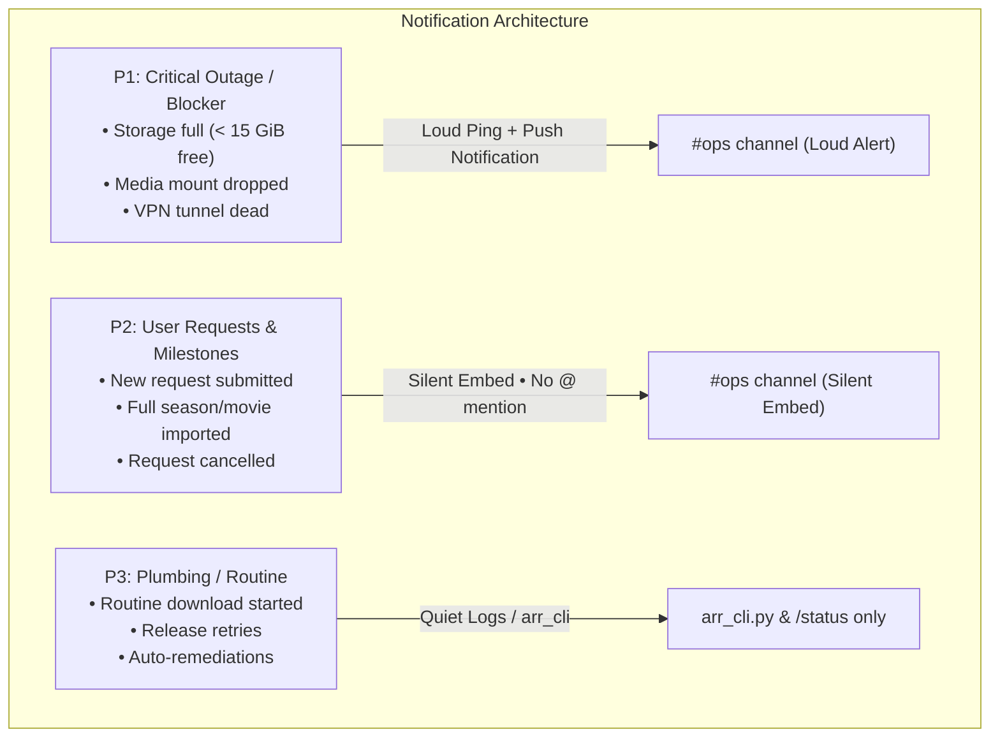

# Push Notifications Reference & 3-Tier Architecture

## Overview

The stack pushes alerts via [ntfy](https://ntfy.sh), an HTTP-based publish-subscribe notification service. Services publish events directly to a configured topic, and the Discord bridge subscribes to mirror alerts into the ops channel.



> **Security notice:** Public ntfy topics do not require authentication; access is restricted solely by topic entropy. Generate a cryptographically random topic name (`openssl rand -hex 12`) and store it exclusively in `/etc/homelab/homelab.env`.

---

### Tier Matrix

| Tier | Events | Destination | Mentions / Push | Format |
|---|---|---|---|---|
| **P1: Critical Outage / Blocker** | • Host media storage unmounted (`${MEDIA_ROOT}`)<br>• Storage full (< 15 GiB free)<br>• VPN tunnel dead<br>• Arr service crash loop | Ops channel + ntfy (High Priority) | **Tags Administrator** + Loud Mobile Push | Storage verification or capacity alert with the failure reason |
| **P2: User Requests & Lifecycle** | • New Jellyseerr request submitted<br>• User cancellation<br>• Watchdog notice (no sources found)<br>• Season / Movie fully imported | Ops channel (Silent) + ntfy (Low Priority) | **No `@` tag** (Silent Embed) | Compact summary embed with requesting user, title, size, and pipeline status |
| **P3: Ephemeral Plumbing & Background Jobs** | • Routine download started<br>• Queue auto-remediations (stalled items swapped)<br>• Prowlarr indexer backoff auto-resets | Logged only (or debounced single summary) | **Zero pings / No ntfy** | Tracked via `/status` and `arr_cli.py queue` |

---

## Household User Experience (Personal Request Channels & DMs)

Users receive only actionable lifecycle milestones:
1. **Intake Confirmation:** Immediate embed when they hit `/request` with estimated size and ETA.
2. **Storage notice:** If the configured filesystem fails verification or has less than 15 GiB free, confirmation stops and directs the requester to an administrator.
3. **Watchdog Search Notice (Fallback):** If the autonomous watchdog detects a stalled release and finds that all available indexer releases have 0 sources, the user receives a private notice in their personal request channel:
   > ⚠️ **Download Notice: [Title]**  
   > Our automated watchdog checked all indexers, but could not find an active release with available sources. The system will keep monitoring in case a fresh copy becomes available.
4. **Ready to Stream:** When Jellyfin finishes library import, posts a clean `🍿 <Title> is ready to watch!` with a direct stream link.
5. *Suppressed:* Users never see raw speeds, download hashes, indexer queries, or internal retry attempts.

---

## Operator SRE Plane (Ops Channel & Mobile Alerts)

- **Noise Suppression & Debouncing:**
  - `ntfy_event_listener_loop` debounces bursts of notifications (e.g. multi-episode season packs) within a 25-second window so only a single summary card is posted.
  - Routine requests and cancellations post silent rich embeds without `@operator` pings.
- **Critical Alerts:**
  - Storage full (< 15 GiB free) and drive unmount events trigger loud alerts with operator mentions.

---

## Jellyseerr Configuration

Configure in Jellyseerr under **Settings → Notifications → ntfy.sh**:

| Field | Value |
| :--- | :--- |
| Server URL | `https://ntfy.sh` (or self-hosted URL) |
| Topic | Configured topic string (`NTFY_TOPIC`) |

**Triggers to enable:**
- Request Automatically Approved
- Request Pending Approval *(optional; omit if auto-approval is enabled)*

---

## Radarr and Sonarr Configuration

To prevent season-pack notification floods (e.g. 10–24 pushes for a single TV season), **"On Grab" alerts are disabled** in Radarr and Sonarr under **Settings → Connect**.

| Field | Value |
| :--- | :--- |
| Connection Type | ntfy |
| Trigger | On Import (Optional) / Off for On Grab |
| Server URL | `https://ntfy.sh` |
| Topic | Configured topic string (`NTFY_TOPIC`) |
| Click Action URL | `http://192.168.1.14:8080` |

---

## Self-hosting ntfy

The compose stack includes an ntfy container. Self-hosting keeps notification
metadata off a third-party server; the tradeoff is that mobile push notifications
require handing instant notifications upstream anyway.

> **`NTFY_BASE_URL` and `NTFY_UPSTREAM_BASE_URL` must be set together.** If
> `NTFY_UPSTREAM_BASE_URL` is set to forward instant notifications for mobile
> clients, but `NTFY_BASE_URL` is left undefined, ntfy fails its startup
> validation and the container crash-loops. Set both in `.env` before deploying.

---

## Troubleshooting

### Notifications not arriving on mobile device
1. Confirm the app is installed and subscribed to the exact topic string (`NTFY_TOPIC`) — these are case-sensitive and a typo fails silently.
2. Check the OS notification permission for the ntfy app.
3. Confirm the server URL matches exactly, with no trailing slash.
4. Test the path independently of the applications:
   ```bash
   curl -d "test from the homelab" https://ntfy.sh/<your-topic>
   ```
   If that arrives and application alerts do not, the problem is the application's connection config, not ntfy.

### Watchdog auto-remediation alerting
- State tracking lives at `/opt/homelab/.arr_remediation_state.json`.
- When testing or inspecting remediation attempts:
  ```bash
  python3 /opt/homelab/scripts/arr_cli.py --json queue auto-remediate
  ```

### Alerts reach phone but not the Discord ops channel
The bridge streams from `NTFY_STREAM_URL`, which is a different variable from the one the applications use, and it must point at the JSON endpoint: `https://ntfy.sh/<your-topic>/json`. Check `journalctl -u homelab-bot -n 50`.
