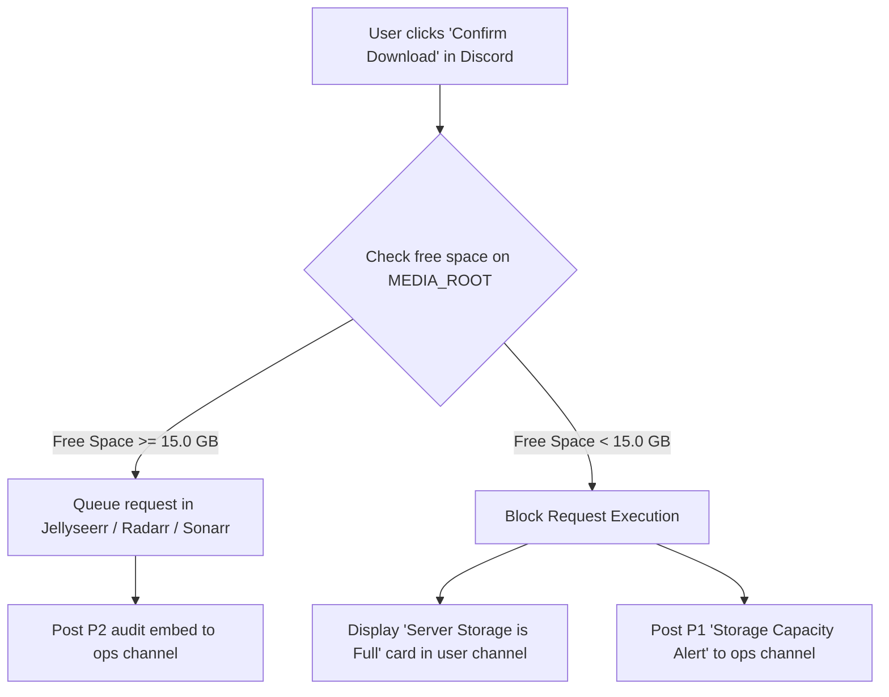

# Storage Capacity Management & Runbook

## Overview
The homelab utilizes shared external or pool storage mounted at `${MEDIA_ROOT}` (e.g. `/mnt/media`) as the single source of truth for all media datasets. This storage is bind-mounted directly into the media server and media-stack containers and mapped into services under `/media`.

When the storage drive operates near peak utilization (typically >90% capacity), strict storage guardrails, pre-flight allocation gates, and operational runbooks are enforced to prevent disk fill-ups, filesystem corruption, or writes spilling onto the host root drive (`/`).

---

## 1. Automated Storage Pre-Flight Gate (`/request`)

The Discord Gateway Bridge (`scripts/discord_bridge.py`) implements an automated pre-flight disk capacity verification gate before any user download request is submitted to Jellyseerr, Radarr, or Sonarr:



### Safety Threshold (15 GB Safe Buffer)
- **Threshold:** `15.0 GB free` on `${MEDIA_ROOT}`.
- **Rationale:** Prevents incomplete downloads from freezing the download client, prevents hardlink import failures in Radarr/Sonarr, and ensures headroom for SQLite database operations in Jellyfin and the Arr services.

### User Experience (Household Plane)
When free space drops below 15 GB, the user's confirmation interaction is stopped immediately. The bot updates the embed to an orange warning card:
> 📦 **Server Storage is Full**  
> The server is currently low on storage space, so your request for **[Title]** couldn't start yet.  
> Please contact an administrator so they can clear some space for you!

### Operator Alerting (Operator SRE Plane)
Simultaneously, a **P1 Critical Alert** is dispatched to the ops channel:
- **Title:** `🚨 Storage Capacity Alert`
- **Fields:**
  - **User:** Requester mention and username
  - **Requested Media:** Title and media type
  - **Available Space:** Exact free GB (Below 15 GB safe threshold)
  - **Action Required:** `Clear host media drive space.`

---

## 2. Storage Inspection & Diagnostics

Operators and the SRE agent can inspect storage metrics at multiple granularities:

### High-Level Host Disk Check
Verify overall disk utilization and mount health:
```bash
df -h ${MEDIA_ROOT}
```
*Expected healthy state:* Mounted on `${MEDIA_ROOT}`, with at least 15–20 GB available headroom.

### Conversational SRE Inquiries (`!agent`)
The SRE agent can analyze storage usage directly from the ops channel:
- **Overall Storage Breakdown:**
  ```text
  !agent what is taking up the most storage?
  ```
  Returns total media allocation, breakdown between TV series and Movies, active download footprint, and a list of top space-consuming items.
- **Series Breakdown by Season:**
  ```text
  !agent break down size of <series title> by season
  ```
  Inspects season folders, episode counts, and codecs to identify specific high-yield seasons to prune.

### Direct Command-Line Breakdown
Run directory-level queries on the media mount:
```bash
# Top-level media breakdown (Movies vs TV vs Downloads)
du -sh ${MEDIA_ROOT}/*

# Top 10 largest TV shows
du -sh ${MEDIA_ROOT}/tv/* | sort -rh | head -n 10

# Top 10 largest Movies
du -sh ${MEDIA_ROOT}/movies/* | sort -rh | head -n 10
```

---

## 3. Safe Media Pruning Procedures

When storage drops below the 15 GB threshold, space must be reclaimed. Follow these safe pruning procedures to prevent broken library references or unwanted re-downloads.

### Strategy A: Pruning Watched TV Series / Seasons (High Yield)
Multi-season TV series represent the largest storage footprint across the library.

1. **Delete via Sonarr GUI (Preferred):**
   - Open Sonarr.
   - Open the target series.
   - Click the **Season Management** icon or open specific seasons.
   - Select the season(s) to delete.
   - Click the **Delete** icon.
   - ⚠️ **Critical:** Ensure **"Delete files from disk"** is checked.
   - ⚠️ **Critical:** Ensure the deleted season/series is marked as **Unmonitored** (bookmark icon hollow). If left monitored, Sonarr will trigger automated searches to replace the deleted files!

2. **Delete via Jellyseerr:**
   - In Jellyseerr, open the request and select **Delete Request** to align user intake status.

### Strategy B: Pruning Watched or Bloated Movies
High-bitrate movies (e.g. 20–25 GB 4K/Remux releases) can be pruned or downscaled to 1080p.

1. **Delete via Radarr GUI:**
   - Open Radarr.
   - Locate the target movie.
   - Click **Delete Movie**.
   - Check **"Delete files"**.
   - Uncheck **"Exclude Movie from Auto-Import"** if deleting permanently, and unmonitor if not replacing.

### Strategy C: Post-Pruning Library Rescan
Once files are deleted from disk, refresh Jellyfin so the deleted titles disappear immediately from user streaming interfaces:
```bash
python3 /opt/homelab/scripts/arr_cli.py jellyfin refresh
```

---

## 4. Quality Guardrails Against Storage Bloat

To avoid rapid storage depletion on finite storage drives:

| Media Type | Recommended Profile | Average Size | Max Ceiling | Notes |
| :--- | :--- | :--- | :--- | :--- |
| **Movies (Routine)** | `HD-1080p` | ~2.5 – 4.5 GB | 7.5 GB | Strict cap via Radarr Quality Definitions (75 MB/min). |
| **Movies (Cinematic)** | `Ultra-HD` (4K) | ~8.0 – 14.0 GB | 18.5 GB | Reserved for visual blockbusters. |
| **Movies (Remux)** | Deprioritized | 30 – 80 GB+ | Disc Rip | Scored `-50` in Custom Formats; grabbed only as last resort. |
| **TV Shows (Full Season)** | `HD-1080p` (x265) | ~1.0 – 1.4 GB / ep | ~15 – 20 GB / season | Standard HEVC/x265 encoding profile. |
| **TV Shows (4K)** | `Ultra-HD` (4K) | ~4.0 – 6.0 GB / ep | ~40 – 60 GB / season | High disk impact; recommend single season intake. |

---

## 5. Storage Incident Runbook: Storage Full Alert

When the ops channel receives a `🚨 Storage Capacity Alert`:

1. **Acknowledge Alert:** Check which user and media triggered the alert.
2. **Assess Free Space:**
   ```bash
   df -h ${MEDIA_ROOT}
   ```
3. **Identify Pruning Candidates:**
   ```text
   !agent what is taking up the most storage?
   ```
4. **Coordinate with Household Users:** Confirm if finished seasons or completed movies can be removed.
5. **Delete Files cleanly** via Sonarr/Radarr (with "Delete files" checked and unmonitored).
6. **Verify Headroom:** Ensure `${MEDIA_ROOT}` has at least 25–50 GB free headroom.
7. **Notify Requesting User:** Let the user know in their personal request channel that space has been cleared and they can re-click `Confirm Download` or submit their `/request`.
