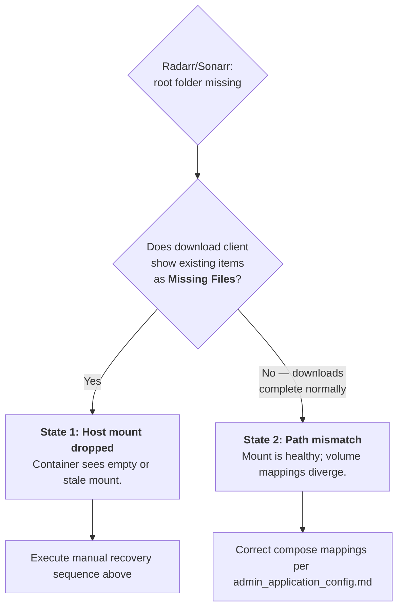

# Storage Recovery Runbook

Manual recovery procedures and diagnosis for dropped storage mounts.

For automated recovery, see [Storage Watchdog](admin_storage_watchdog.md).

> **Important:** Stop all containers holding media bind mounts prior to remounting storage. Remounting while containers are active creates stale file handles in the container filesystem.

## Maintenance Mode

The automated watchdog checks mount status every 15 seconds. Create the maintenance lock before performing manual disk operations:

```bash
touch /tmp/maintenance.lock     # suspends watchdog execution
# ... perform maintenance ...
rm -f /tmp/maintenance.lock     # resumes watchdog execution
```

Verify lockfile presence with `ls -l /tmp/maintenance.lock`.

## Manual Recovery Sequence

Check current mount and container status:

```bash
mountpoint -q /mnt/media && echo mounted || echo "NOT MOUNTED"
pct status 201
pct status 204
```

If storage is unmounted or returning I/O errors:

```bash
touch /tmp/maintenance.lock

pct stop 201
pct stop 204

umount -l /mnt/media || true   # lazy unmount clears stale handles
mount /mnt/media
sync
umount /mnt/media
mount /mnt/media

mountpoint -q /mnt/media || { echo "ERROR: Storage failed to mount"; }

pct start 201
pct start 204
rm -f /tmp/maintenance.lock
```

Confirm containers report `status: running`.

**Mount cycling rationale:** A single remount can retain stale kernel file handles. Cycling through mount, sync, unmount, and mount forces a clean kernel attachment.

## Ghost Mounts

If physical storage disconnects, the mount directory may remain visible while reads return I/O errors:

```text
ls: reading directory '/media': I/O error
```

> **Warning:** Never execute `mkdir -p` against the media path without checking `mountpoint -q` first. If unmounted, directories are created on the host root filesystem, leading to boot disk exhaustion.

The lazy unmount (`umount -l`) in the recovery sequence clears ghost file handles.

## Diagnosing "Root folder does not exist"

Missing root folder warnings in Radarr/Sonarr indicate either dropped host storage or container path divergence:



- **State 1:** Host mount dropped. Execute the manual recovery sequence above.
- **State 2:** Mount is healthy but volume paths diverge between containers. Correct path mappings in Docker Compose. See [admin_application_config.md](admin_application_config.md).

## Isolating Failures by Layer

Verify layers sequentially before modifying configurations:

**1. Host layer:**

```bash
ls -la /mnt/media
```

If the directory is empty or missing expected subdirectories, the host mount is down. Execute the manual recovery sequence.

**2. Container layer:**

```bash
pct exec 204 -- ls -la /mnt/media
```

If the host sees media but the container sees an empty directory, restart the container to refresh the bind mount:

```bash
pct stop 204 && pct start 204
```

**3. Docker layer:**

```bash
pct exec 204 -- docker exec radarr ls -la /media
```

If the host and container see media but Docker containers show empty directories, check Docker Compose volume mappings:

```yaml
- ${MEDIA_ROOT}:/media
```

Recreate the stack:

```bash
cd /opt/appdata && docker compose down && docker compose up -d
```

## Host UID Mapping (`101000`)

Host permissions on the media tree should reflect UID `101000`:

```bash
ls -la /mnt/media/downloads
# drwxr-xr-x  101000 101000  ...
```

Unprivileged LXC containers offset host UIDs by `100000`, so host UID `101000` maps to UID `1000` inside the container (the `PUID`/`PGID` used by media containers).

> **Important:** Do not modify ownership to host UID `1000` or apply `chmod 777`. Unprivileged container isolation depends on this mapping.

## Recovery Failure Scenarios

**Container fails to stop within timeout:** Abort remount. Unmounting storage underneath an active container risks filesystem corruption. Inspect container processes before retrying.

**Mount verification fails after cycling:** Leave containers stopped. Check physical connections, power, and kernel logs: `dmesg -T | tail -50`.

**Library rescan fails after mount recovery:** Storage recovery is intact. Trigger library scan manually: `python3 scripts/arr_cli.py jellyfin refresh`.
