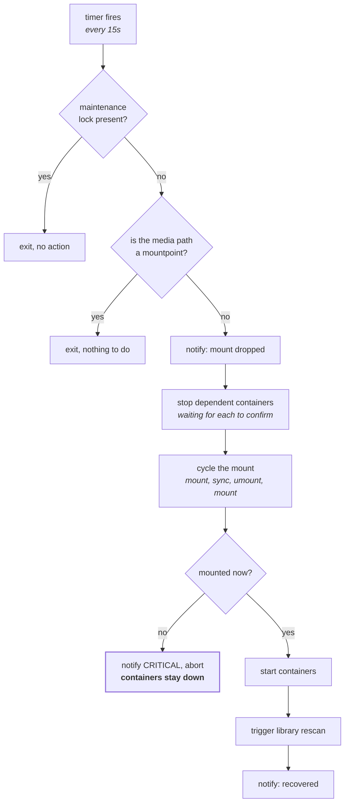

# Storage Watchdog Reference

Configuration and deployment reference for [`scripts/check_storage.sh`](../scripts/check_storage.sh), an automated recovery service that monitors media storage mount health.

For manual recovery procedures, see [Storage Recovery](admin_storage_recovery.md).

## Operational Workflow



If mount recovery fails, containers remain stopped to prevent unmounted write operations to the host root filesystem.

## Check Interval & Concurrency

A systemd timer triggers the watchdog every 15 seconds. The lightweight `mountpoint -q` check minimizes disk exposure time if external storage drops. Concurrency is managed via `flock` to ensure overlapping executions are discarded while a recovery sequence is active.

## Prerequisites

Host binary dependencies on `PATH`:

```bash
command -v pct curl mountpoint mount umount sync awk flock
```

`pct` execution requires running directly on the Proxmox VE hypervisor host.

## Deployment

```bash
# 1. Place the repo clone where the script and its units expect it
git clone <your-fork> /opt/homelab

# 2. Configuration lives in the environment file, not in the script
install -d -m 0750 /etc/homelab
install -m 0600 /opt/homelab/scripts/homelab.env.example /etc/homelab/homelab.env
$EDITOR /etc/homelab/homelab.env

# 3. Install the units
install -m 0644 /opt/homelab/config/templates/systemd/storage-watchdog.service /etc/systemd/system/
install -m 0644 /opt/homelab/config/templates/systemd/storage-watchdog.timer   /etc/systemd/system/

systemctl daemon-reload
systemctl enable --now storage-watchdog.timer
```

Confirm it is armed:

```bash
systemctl status storage-watchdog.timer     # expect: Active: active (waiting)
systemctl list-timers storage-watchdog.timer
```

## Configuration

Everything is read from `/etc/homelab/homelab.env` (override the path with
`HOMELAB_ENV_FILE`). Nothing needs editing inside the script.

| Variable | Purpose | Default |
| :--- | :--- | :--- |
| `MEDIA_ROOT` | Mount point to watch | `/mnt/media` |
| `WATCHDOG_CT_IDS` | Space-separated container IDs to stop and restart | `201 204` |
| `MEDIA_SERVER_IP` | Media server to ask for a rescan after recovery | *unset — rescan skipped* |
| `MEDIA_SERVER_PORT` | Media server port | `8096` |
| `JELLYFIN_API_KEY` | Key for the rescan call | *unset — rescan skipped* |
| `NTFY_BASE_URL` | Notification server | `https://ntfy.sh` |
| `NTFY_TOPIC` | Notification topic | *unset — notifications skipped* |
| `MAINTENANCE_LOCK` | Lockfile suppressing all action | `/tmp/maintenance.lock` |
| `STOP_TIMEOUT` | Seconds to wait for a container to stop before aborting | `30` |

Unset optional values degrade gracefully: no topic means no notifications, not
a crash. The required behaviour — detect, stop, cycle, restart — works with
nothing configured but `MEDIA_ROOT` and `WATCHDOG_CT_IDS`.

## Verification & Testing

**Simulate mount failure:**

```bash
# Simulate a dropped mount
umount -l /mnt/media

# Monitor watchdog execution
journalctl -u storage-watchdog.service -f
```

Expected log events: containers stop, mount cycles, containers start, and rescan notification is sent.

Confirm healthy state:

```bash
mountpoint -q /mnt/media && echo recovered
pct status 201; pct status 204
```

**Verify maintenance override lock:**

```bash
touch /tmp/maintenance.lock
umount -l /mnt/media
sleep 30

# Verify watchdog remained idle
mountpoint -q /mnt/media || echo "Watchdog correctly stood down"

mount /mnt/media
rm -f /tmp/maintenance.lock
```

## Maintenance & Updates

Update script via git repository pull:

```bash
cd /opt/homelab && git pull
```

If deployed outside `/opt/homelab`, compare differences prior to updating:

```bash
diff -u /opt/homelab/scripts/check_storage.sh /usr/local/bin/check_storage.sh
```

## Troubleshooting

**Watchdog does not respond to dropped mount:** Inspect service logs via `journalctl -u storage-watchdog.service -n 50`. Check for a stale `/tmp/maintenance.lock`.

**Mount recovers but library rescan is skipped:** Confirm `MEDIA_SERVER_IP` and `JELLYFIN_API_KEY` are configured in `/etc/homelab/homelab.env`.

**Notifications not delivered:** Verify `NTFY_TOPIC` is defined and host has outbound HTTPS connectivity. Test with: `curl -d test https://ntfy.sh/<your-topic>`.

**Containers remain stopped after failure:** Mount recovery failed verification. Inspect hardware connections, cabling, and kernel logs: `dmesg -T | tail -50`.
