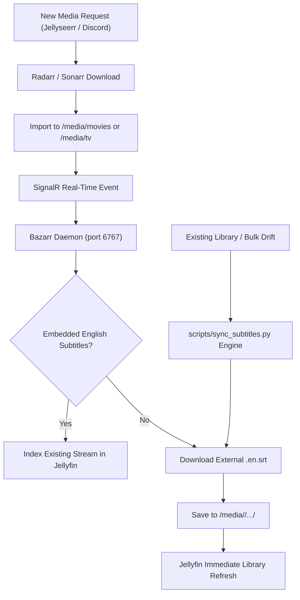

# Subtitle Management & Automated English Subtitle Architecture

## Overview
This runbook covers the end-to-end subtitle architecture for the homelab, ensuring that **every piece of media has at least English subtitles** and establishing an automated rule that **any new media requests automatically get English subtitles** upon import.

## Dual-Layer Subtitle Architecture

To guarantee 100% English subtitle coverage without manual operator intervention, the homelab implements a dual-layer architecture:



### 1. Continuous Ingestion Rule (Bazarr Daemon)
- **Container**: `bazarr` (`lscr.io/linuxserver/bazarr:latest`) running in the media-stack container on port `6767`.
- **Radarr & Sonarr Integration**: Connected via real-time WebSocket (SignalR) event feeds and REST APIs.
- **Default Profile**: Profile 1 (`English`) is configured as the default for all movies and TV shows (`movie_default_profile: 1`, `serie_default_profile: 1`).
- **Autonomous Subtitle Fetching**: As soon as Radarr or Sonarr finishes downloading and importing any media, Bazarr receives the event, verifies whether embedded English subtitles exist, and automatically searches and grabs subtitles from configured providers (`yifysubtitles`, `gestdown`, `subf2m`, `podnapisi`, `supersubtitles`, `tvsubtitles`, `bsplayer`, `embeddedsubtitles`).
- **Jellyfin Notification**: Once subtitles are acquired, Bazarr signals Jellyfin to refresh the affected library item immediately.

### 2. Standalone Remediation & Synchronization Engine (`sync_subtitles.py`)
- **Script**: `python3 /opt/homelab/scripts/sync_subtitles.py`
- **Purpose**: Fast, high-throughput bulk remediation across both tracked and manually transferred media.
- **High-Efficiency Providers**:
  - **TV Episodes**: Gestdown REST API (`api.gestdown.info`) queried via TVDB IDs for instant season/episode resolution.
  - **Movies**: YIFY Subtitles API (`yifysubtitles.ch`) with automated fallback to SubDL via Flaresolverr (`http://192.168.1.14:8191`).
- **File Standards**: Writes standardized `<basename>.en.srt` files directly into the media directory with ownership matching container mapping (`PUID:PGID`, mode `0664`).

## CLI Commands (`arr_cli.py`)

The homelab helper CLI exposes dedicated commands for checking subtitle coverage and triggering synchronization:

```bash
# Check library-wide English subtitle coverage statistics
python3 /opt/homelab/scripts/arr_cli.py subtitles status

# Execute automated subtitle synchronization across all missing items
python3 /opt/homelab/scripts/arr_cli.py subtitles sync

# Preview missing subtitles without downloading
python3 /opt/homelab/scripts/arr_cli.py subtitles sync --dry-run

# Inspect Bazarr daemon health and Radarr/Sonarr connectivity
python3 /opt/homelab/scripts/arr_cli.py bazarr status

# Trigger missing subtitle search tasks across the Bazarr daemon
python3 /opt/homelab/scripts/arr_cli.py bazarr search-missing

# Force Bazarr to resynchronize its library with Radarr and Sonarr
python3 /opt/homelab/scripts/arr_cli.py bazarr sync
```

Append `--json` to any command for structured JSON output.

## Jellyfin Library Options

Jellyfin libraries (`Movies` and `Shows`) are configured with:
- `SubtitleDownloadLanguages`: `eng` (English prioritized)
- `SaveSubtitlesWithMedia`: `true` (saves subtitles alongside media files rather than internal caches)
- `RequirePerfectSubtitleMatch`: `false`
- `Open Subtitles` plugin installed in Jellyfin for native UI subtitle search and fallback downloads.

## Verification & Health Checks

Verify 100% English subtitle coverage across the entire active library:
```bash
python3 /opt/homelab/scripts/arr_cli.py subtitles status
```

Expected healthy output:
```text
═══════════════════════════════════════════════════════════
           ENGLISH SUBTITLE COVERAGE STATUS                
═══════════════════════════════════════════════════════════
 Total Media Files Checked : 682
 Files with English Subs   : 682 (100.0%)
 Files Missing English Subs: 0
───────────────────────────────────────────────────────────
 ✅ 100% of media files have English subtitles!
═══════════════════════════════════════════════════════════
```
