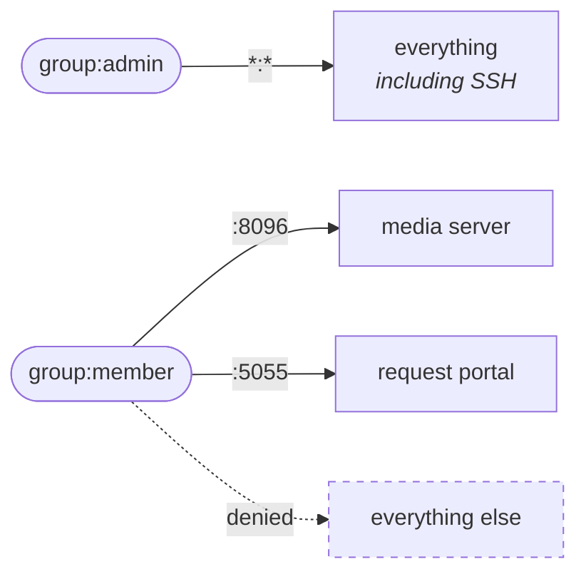

# Tailnet Access Control

## Overview

Remote access to this homelab is Tailscale-only. Nothing is port-forwarded from
the router, and no service is exposed to the public internet. The ACL policy
source lives at
[`config/templates/tailscale/acl.json`](../config/templates/tailscale/acl.json).

> **Commit ACL changes to the repo before deploying them.** The Tailscale admin
> console is an editor, not a source of truth. A policy edited only in the
> console has no history and no review.

## Access Control Model

Access is partitioned into two functional roles:

| Group | Reach |
| :--- | :--- |
| `group:admin` | Unrestricted network access (`*:*`) |
| `group:member` | Restricted access scoped to media services |



Household members have access restricted strictly to playback and media request portals. Access to the Proxmox hypervisor web UI, download clients, indexers, automation APIs, and SSH is restricted to administrative identities.

| Destination | Port | Service |
| :--- | :--- | :--- |
| `192.168.1.11` | `8096` | Media server |
| `192.168.1.14` | `5055` | Request portal |

## SSH Access Control

Tailscale SSH is restricted to `group:admin` in `action: check` mode rather than `accept`. The `check` policy requires session re-authentication:

```json
{
  "action": "check",
  "src":    ["group:admin"],
  "dst":    ["tag:homelab"],
  "users":  ["root", "autogroup:nonroot"]
}
```

`tag:homelab` is administered exclusively by `group:admin`.

## Security Policies

- Do not grant wildcard destinations (`*:*`) to `group:member`.
- Maintain SSH in `action: check` mode.
- Restrict destinations to explicit `address:port` pairs rather than entire hosts or subnets.
- Version control all ACL modifications in `config/templates/tailscale/acl.json`.

## Verification

Verify member endpoints are defined in the template:

```bash
grep -n '192.168.1.11:8096' config/templates/tailscale/acl.json
grep -n '192.168.1.14:5055' config/templates/tailscale/acl.json
```

Verify reachability from a member client:

```bash
tailscale status
curl -s -o /dev/null -w '%{http_code}\n' http://192.168.1.11:8096/health
```

Expected status: `200` for allowed ports (`8096`, `5055`); connection timeout or refusal for unapproved ports (e.g., `8006`, `8080`).

## Troubleshooting

**Members lost access after a policy change.** Restore the last known-good
`acl.json` from git, redeploy, and re-run the verification above. Tailscale
applies policy atomically, so a partial state means the deploy failed, not that
it half-applied.

**Everything is unreachable after a power cut.** Tailscale agents reconnect on
their own once the host is up. If a device stays offline, check that the
`tailscaled` service is enabled rather than merely started —
`systemctl is-enabled tailscaled`.

**A member can reach more than they should.** Check for a stale wildcard rule
and for devices carrying `tag:homelab` that should not. Tags grant reach
independently of group membership.
