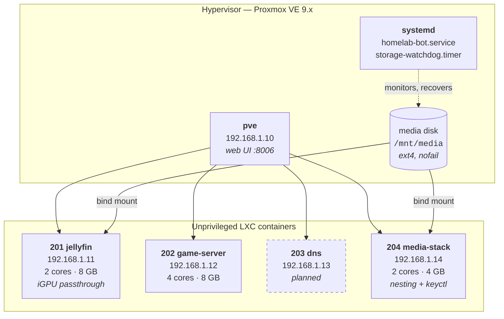
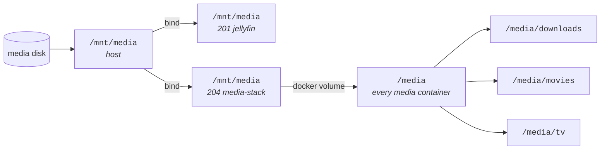
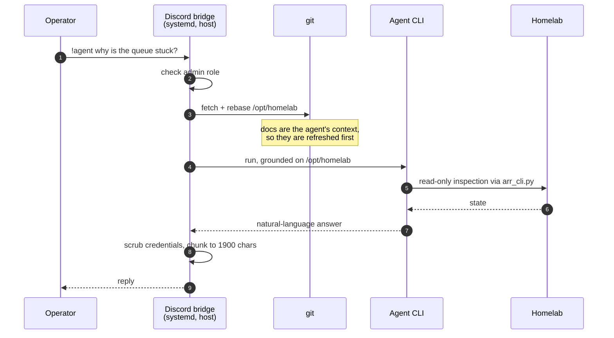
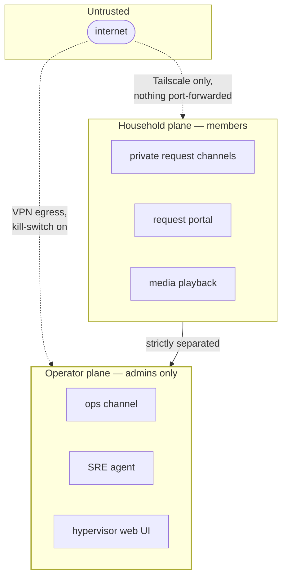

# Architecture

System topology, naming schemes, and design specifications. Setup procedures: [Setup Guide](setup/01-proxmox-host.md).

## Naming Conventions

Container IDs and IP addresses are assigned independently and recorded in [application_ports.md](application_ports.md). Independent numbering avoids coupling container IDs to network subnets.

Service names used across the system:

| Name | Container | Role |
| :--- | :--- | :--- |
| `jellyfin` | 201 | Media server, hardware transcoding |
| `game-server` | 202 | Game server panel |
| `dns` | 203 | Local DNS filtering *(planned, not deployed)* |
| `media-stack` | 204 | Docker host for the acquisition and request services |
| `homelab-bot` | *host* | systemd service running the Discord bridge |

## Topology

`203 dns` is reserved but not deployed.

## Storage

Unified filesystem and path hierarchy across services:

**Unified path requirement:** Hardlinking functions only within a single filesystem where both the writer and importer resolve identical paths. Mismatched paths force fallback to full file copying (doubling disk usage) or cause import errors. See [admin_application_config.md](admin_application_config.md).

**`nofail` mount option:** External storage uses the `nofail` option in `/etc/fstab` so the host boots cleanly if the drive is disconnected or slow to initialize.

**UID ownership:** The media directory is owned by UID `101000` on the host, which maps to UID `1000` inside unprivileged containers. Incorrect host ownership causes permission errors inside containers. See [setup/03-lxc-containers.md](setup/03-lxc-containers.md).

## SRE Agent Architecture

Administrative management-plane component, isolated from household channels.

**Design specifications:**

- **Documentation grounding:** The agent answers strictly from repository documentation and local runbooks.
- **Automated repository sync:** The bridge pulls the repository prior to each invocation to ensure up-to-date runbook context.

## Trust boundaries

- Nothing is exposed to the internet by port forwarding. Remote access is
  Tailscale, with an ACL granting members exactly two destinations.
- Download client egress is forced through a VPN container with a kill-switch:
  if the tunnel drops, traffic is blocked rather than falling back to the ISP
  connection.
- Agent commands are restricted to the ops channel, and household command interactions are ephemeral.

## Scope & Non-Goals

- **Manual deployment reference:** Designed as a reference architecture with templates and runbooks rather than Terraform/Ansible automation.
- **Single-node reliability:** High availability clustering is out of scope; resilience is provided via automated storage watchdog and backup procedures.
- **Access tiers:** Two trust domains: household members and system administrators.
