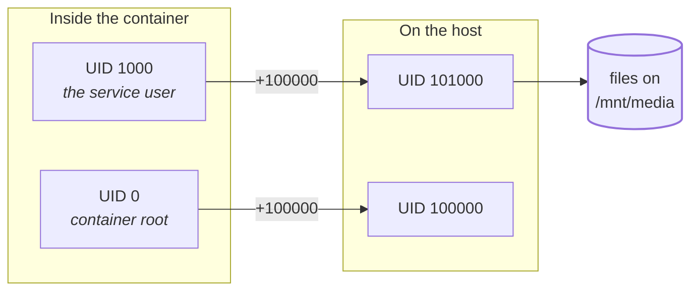

# 3 — LXC Container Configuration

**Objective:** Deploy two unprivileged LXC containers (CT 201 for Jellyfin, CT 204 for Docker media stack) with static IP assignments and persistent bind mounts to `/mnt/media`.

---

## Architectural Notes

LXC containers share the host Linux kernel, providing native performance and allowing direct filesystem bind mounts. Bind mounting `/mnt/media` into multiple containers allows hardlinks across containers sharing the filesystem.

Unprivileged LXC containers map root (UID 0) inside the container to an unprivileged host UID (UID 100000).

---

## UID Mapping



Unprivileged containers apply a UID offset of `+100000`:
- Process running as UID `1000` inside writes files owned by host UID `101000`.
- Media applications run under `PUID=1000` / `PGID=1000`.
- Storage mounted at `/mnt/media` must be owned on the host by `101000:101000`.

> **Note:** If permission errors occur on the bind mount, verify host directory ownership is set to `101000:101000`. Do not modify permissions to `chmod 777`.

---

## Download Container Template

```bash
pveam update
pveam available --section system | grep debian
pveam download local debian-13-standard_13.x_amd64.tar.zst
pveam list local
```

Debian is a reasonable default: small, stable, and what most upstream
documentation assumes.

---

## Create Media Server Container (CT 201)

```bash
pct create 201 local:vztmpl/debian-13-standard_13.x_amd64.tar.zst \
  --hostname jellyfin \
  --cores 2 \
  --memory 8192 \
  --swap 512 \
  --rootfs local-lvm:16 \
  --net0 name=eth0,bridge=vmbr0,ip=192.168.1.11/24,gw=192.168.1.1 \
  --features nesting=1 \
  --unprivileged 1 \
  --onboot 0 \
  --tags media
```

| Flag | Description |
| :--- | :--- |
| `--rootfs local-lvm:16` | 16 GB root volume allocation |
| `--memory 8192` | 8 GB RAM allocation for transcoding operations |
| `--features nesting=1` | Required for systemd and service operations |
| `--unprivileged 1` | Enables user namespace UID offset mapping |
| `--onboot 0` | Start the media containers explicitly after verifying storage |

Configure the host bind mount:

```bash
pct set 201 -mp0 /mnt/media,mp=/mnt/media
```

---

## Create Media-Stack Container (CT 204)

```bash
pct create 204 local:vztmpl/debian-13-standard_13.x_amd64.tar.zst \
  --hostname media-stack \
  --cores 2 \
  --memory 4096 \
  --swap 512 \
  --rootfs local-lvm:16 \
  --net0 name=eth0,bridge=vmbr0,ip=192.168.1.14/24,gw=192.168.1.1,firewall=1 \
  --features nesting=1,keyctl=1 \
  --unprivileged 1 \
  --onboot 0 \
  --tags media

pct set 204 -mp0 /mnt/media,mp=/mnt/media
```

Key configuration parameters:
- `keyctl=1` — Kernel keyring access required by Docker containerd.
- `nesting=1` — Required for containerized Docker execution within LXC.

### TUN Passthrough for VPN Container

Gluetun requires `/dev/net/tun` for WireGuard encapsulation. Append cgroup and mount rules to `/etc/pve/lxc/204.conf`:

```bash
cat >> /etc/pve/lxc/204.conf <<'EOF'
lxc.cgroup2.devices.allow: c 10:200 rwm
lxc.mount.entry: /dev/net/tun dev/net/tun none bind,create=file
EOF
```

Reference configs: [`lxc-jellyfin.conf`](../../config/examples/pve/lxc-jellyfin.conf), [`lxc-media-stack.conf`](../../config/examples/pve/lxc-media-stack.conf).

---

## Install the storage startup hook

Use the repository checkout at `/opt/homelab` from [storage setup](02-storage.md). In Proxmox, add **Snippets** to the existing content types on the `local` directory storage, then install the hook and attach it to each media container.

```bash
install -D -m 0755 /opt/homelab/scripts/media-storage-hook.sh /var/lib/vz/snippets/media-storage-hook.sh
pct set 201 --hookscript local:snippets/media-storage-hook.sh
pct set 204 --hookscript local:snippets/media-storage-hook.sh
```

## Start and Initialize Containers

```bash
timeout 20 python3 /opt/homelab/scripts/media_storage.py --json && pct start 201 && pct start 204
pct status 201; pct status 204        # verify status: running
```

Update packages inside both containers:

```bash
pct exec 201 -- bash -c 'apt update && apt full-upgrade -y && apt install -y curl ca-certificates'
pct exec 204 -- bash -c 'apt update && apt full-upgrade -y && apt install -y curl ca-certificates'
```

---

## Verification

Verify storage visibility and UID mappings:

```bash
# Host view: owned by 101000:101000
ls -la /mnt/media

# Container view: appears as 1000:1000
pct exec 201 -- ls -la /mnt/media
pct exec 204 -- ls -la /mnt/media

# Network reachability
pct exec 201 -- ping -c2 192.168.1.1
pct exec 204 -- ping -c2 1.1.1.1

# Verify TUN device in CT 204
pct exec 204 -- ls -la /dev/net/tun
```

Test write UID mapping:

```bash
pct exec 204 -- bash -c 'id -u; touch /mnt/media/downloads/uidtest; ls -la /mnt/media/downloads/uidtest'
ls -la /mnt/media/downloads/uidtest      # Host must show UID 101000
rm -f /mnt/media/downloads/uidtest
```

---

## Troubleshooting

**Container fails to start:** Run `pct start 201 --debug` and review `journalctl -u pve-container@201`.

**Bind mount is empty inside container:** Confirm host mount is mounted (`mountpoint -q /mnt/media`). Restart container if the host storage was remounted after container start.

**Permission denied on bind mount:** Verify host directory ownership is `101000:101000`.

**Docker daemon fails inside CT 204:** Ensure `keyctl=1` and `nesting=1` are configured: `pct set 204 --features nesting=1,keyctl=1`.

**No network connectivity:** Verify bridge name (`vmbr0`) and ensure the assigned static IP does not conflict with existing LAN leases.

---

**Next:** [4 — Media server](04-jellyfin.md)
