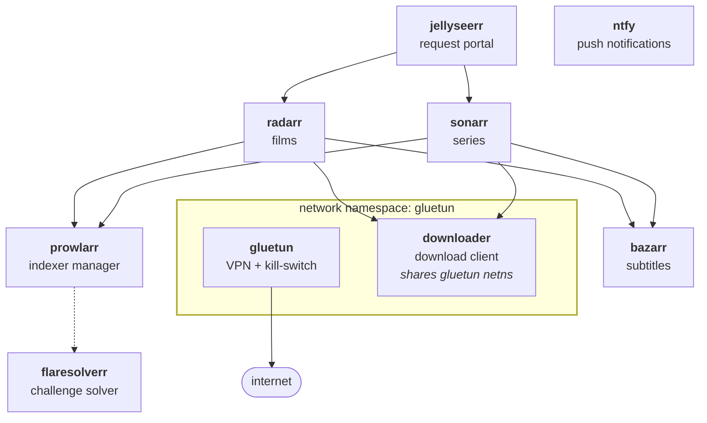

# 5 — Media Stack

Deploy the container stack in container 204: request portal, indexer manager, download client, and VPN egress.

---

## Component Architecture



The download client runs with `network_mode: "service:gluetun"`, sharing Gluetun's network namespace with no independent network access. If the VPN tunnel disconnects, Gluetun's kill-switch blocks outbound traffic.

The download client web UI port is published directly on the `gluetun` service container definition.

---

## Install Docker in the container

```bash
pct exec 204 -- bash -c '
apt update && apt install -y ca-certificates curl gnupg
install -m 0755 -d /etc/apt/keyrings
curl -fsSL https://download.docker.com/linux/debian/gpg \
  | gpg --dearmor -o /etc/apt/keyrings/docker.gpg
echo "deb [arch=$(dpkg --print-architecture) signed-by=/etc/apt/keyrings/docker.gpg] https://download.docker.com/linux/debian $(. /etc/os-release; echo $VERSION_CODENAME) stable" \
  > /etc/apt/sources.list.d/docker.list
apt update && apt install -y docker-ce docker-ce-cli containerd.io docker-compose-plugin
'
pct exec 204 -- docker run --rm hello-world
```

If that last command fails with a keyring or containerd error, the container is
missing `keyctl=1`:

```bash
pct set 204 --features nesting=1,keyctl=1
pct stop 204 && pct start 204
```

---

## Deploy the stack

```bash
pct exec 204 -- mkdir -p /opt/appdata
```

Copy the template and its environment file in:

```bash
# From the hypervisor host, with this repo cloned to /opt/homelab
pct push 204 /opt/homelab/config/templates/docker/media-stack.compose.yml /opt/appdata/docker-compose.yml
pct push 204 /opt/homelab/config/templates/docker/.env.example /opt/appdata/.env
```

Then edit `/opt/appdata/.env` inside the container:

```bash
pct exec 204 -- nano /opt/appdata/.env
```

Required configuration parameters:

| Variable | Set to |
| :--- | :--- |
| `TZ` | Local time zone, e.g. `Europe/London` |
| `MEDIA_ROOT` | `/mnt/media` (must match host bind mount) |
| `VPN_SERVICE_PROVIDER` | Gluetun provider identifier |
| `WIREGUARD_PRIVATE_KEY` | WireGuard private key from VPN provider |
| `WIREGUARD_ADDRESSES` | Interface CIDR from the provider profile when required |
| `SERVER_COUNTRIES` | Target egress country code |
| `NTFY_BASE_URL` | `http://192.168.1.14` |

> **Requirement:** `MEDIA_ROOT` must match the host bind mount from [chapter 3](03-lxc-containers.md).

Refer to Gluetun documentation for provider-specific identifiers. [`config/templates/gluetun/wireguard.conf.example`](../../config/templates/gluetun/wireguard.conf.example) illustrates profile field mappings.

Bring it up:

```bash
pct exec 204 -- bash -c 'cd /opt/appdata && docker compose up -d'
pct exec 204 -- bash -c 'cd /opt/appdata && docker compose ps'
```

---

## Verify VPN Egress and Kill-Switch

Verify that container traffic egresses through the VPN tunnel before configuring downstream services:

```bash
# Egress IP from within the VPN network namespace
pct exec 204 -- docker exec gluetun wget -qO- https://ipinfo.io/ip

# Direct container host egress IP
pct exec 204 -- curl -s https://ipinfo.io/ip
```

> **Verification requirement:** These two IP addresses must differ. If identical, traffic is bypassing the tunnel.

Verify that the kill-switch terminates outbound traffic when the tunnel stops:

```bash
pct exec 204 -- docker stop gluetun
pct exec 204 -- docker exec downloader wget -qO- --timeout=5 https://ipinfo.io/ip
# expected: failure (network unreachable)
pct exec 204 -- docker start gluetun
```

---

## Path Parity Verification

Every media service mounts `${MEDIA_ROOT}:/media`.

Hardlinking requires the download client and importers (Radarr/Sonarr) to reference files using the same path hierarchy. Discrepancies cause imports to degrade to file copies or fail.

Verify directory paths match across containers:

```bash
pct exec 204 -- docker exec downloader ls -la /media
pct exec 204 -- docker exec radarr     ls -la /media
pct exec 204 -- docker exec sonarr     ls -la /media
```

All three must list identical `downloads`, `movies`, and `tv` directories.

---

## Service Verification

```bash
pct exec 204 -- bash -c 'cd /opt/appdata && docker compose ps'
```

Verify service HTTP endpoints:

```bash
for p in 8080 7878 8989 9696 5055; do
  printf "%s: " "$p"
  curl -s -o /dev/null -w '%{http_code}\n' "http://192.168.1.14:$p"
done
```

Expected response codes are `200` or `401`.

---

## Troubleshooting

**`gluetun` restarts in a loop:** Run `docker logs gluetun`. Verify provider credentials and check that `/dev/net/tun` exists (`pct exec 204 -- ls -la /dev/net/tun`). Review TUN passthrough in [chapter 3](03-lxc-containers.md#tun-passthrough-for-the-vpn-container).

**`downloader` fails to start:** Verify that `gluetun` is healthy and running, as `downloader` joins Gluetun's network namespace.

**Downloader web UI unreachable:** The port is published on the `gluetun` container service, not `downloader`. Confirm port mapping in `docker-compose.yml`.

**`ntfy` crash-loops:** `NTFY_BASE_URL` must be set when `NTFY_UPSTREAM_BASE_URL` is defined. Set both or neither.

**Containers start but `/media` is empty:** Verify the host bind mount (`pct exec 204 -- ls /mnt/media`). Confirm host-level storage is mounted before starting containers.

---

**Next:** [6 — First-run configuration](06-first-run-config.md)
