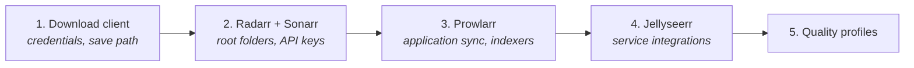

# 6 — First-Run Configuration

Connect and configure application integrations across the stack: download client, Radarr, Sonarr, Prowlarr, and Jellyseerr.

---

## Configuration Workflow



Collect API keys during setup for use in `/etc/homelab/homelab.env` ([chapter 10](10-discord-agent.md)).

---

## 1. Download Client

Access the web interface at `http://192.168.1.14:8080`.

**Initial Authentication:** If generated dynamically on first boot, retrieve the temporary credentials from container logs:

```bash
pct exec 204 -- docker logs downloader 2>&1 | grep -i password
```

Default username is typically `admin`. Set a strong administrative password in the web UI settings.

**LAN Subnet Bypass (Optional):** If preferred for local automation without static credentials, allow access from `192.168.1.0/24` under web UI authentication settings. Otherwise, configure `DOWNLOADER_USERNAME` and `DOWNLOADER_PASSWORD` in `/etc/homelab/homelab.env`.

**Set Save Paths:**

| Setting | Value |
| :--- | :--- |
| Default Save Path | `/media/downloads` |
| Incomplete downloads directory | *disabled* |

> **Requirement:** Do not use a separate incomplete downloads directory across different paths. Maintaining `/media/downloads` ensures atomic hardlinking during library import.

**Verification:**

Confirm `/media/downloads` is accessible:

```bash
pct exec 204 -- docker exec downloader ls /media/downloads
```

---

## 2. Radarr and Sonarr

Access Radarr at `http://192.168.1.14:7878` and Sonarr at `http://192.168.1.14:8989`.

**Authentication:** Configure forms-based authentication with administrator credentials (**Settings → General → Security**).

**Root Folders:** Navigate to **Settings → Media Management → Root Folders → +**:

| Application | Root folder |
| :--- | :--- |
| Radarr | `/media/movies` |
| Sonarr | `/media/tv` |

**Hardlinking:** Under **Settings → Media Management** (Advanced), enable **Use Hardlinks instead of Copy**.

**Connect Download Client:** Navigate to **Settings → Download Clients → +**:

| Field | Value |
| :--- | :--- |
| Host | `localhost` |
| Port | `8080` |
| Username / Password | Configured credentials (or blank if subnet bypass is active) |
| Category | `radarr` (for Radarr) / `sonarr` (for Sonarr) |

> **Note:** Use `localhost` because services communicate within Gluetun's shared network namespace.

Execute **Test** and verify the connection succeeds before saving.

**API Keys:** Copy the API key from **Settings → General → Security → API Key** in both applications.

---

## 3. Prowlarr

Access Prowlarr at `http://192.168.1.14:9696`.

**Authentication:** Configure administrator credentials and copy the API key from **Settings → General**.

**Application Integrations:** Navigate to **Settings → Apps → + → Radarr**:

| Field | Value |
| :--- | :--- |
| Prowlarr Server | `http://localhost:9696` |
| Radarr Server | `http://radarr:7878` |
| API Key | Radarr API key |
| Sync Level | Full Sync |

Repeat for Sonarr using `http://sonarr:8989`. Execute **Test** on both configurations.

> **Note:** Use container service names (`radarr`, `sonarr`) within the Docker network.

**Configure FlareSolverr (Optional):** Navigate to **Settings → Indexers → + → FlareSolverr**:

| Field | Value |
| :--- | :--- |
| Tags | `flaresolverr` |
| Host | `http://flaresolverr:8191` |

Tag only indexers that require challenge-solving proxying.

### Add Indexers

Navigate to **Indexers → Add Indexer** and select configured sources.

After adding, run **Test All** to verify connectivity. Confirm synchronized indexers appear in Radarr and Sonarr (**Settings → Indexers**).

---

## 4. Jellyseerr

Access the request portal at `http://192.168.1.14:5055`.

**Media Server Authentication:** Connect to Jellyfin:

| Field | Value |
| :--- | :--- |
| Jellyfin URL | `http://192.168.1.11:8096` |
| Email / password | Jellyfin administrator account |

Select Movies and TV Shows libraries and initiate library synchronization.

**Service Integrations:** Navigate to **Settings → Services → Radarr → +**:

| Field | Value |
| :--- | :--- |
| Server Name | `Radarr` |
| Hostname | `radarr` |
| Port | `7878` |
| API Key | Radarr API key |
| Quality Profile | `HD-1080p` |
| Root Folder | `/media/movies` |
| Minimum Availability | `Released` |
| Default Server | enabled |

Repeat for Sonarr (hostname `sonarr`, port `8989`, root folder `/media/tv`).

> **Recommendation:** Set Minimum Availability to `Released` to avoid queuing items prior to release availability.

Copy the API key from **Settings → General**.

**Permissions:** Under **Settings → Users → General**, configure auto-approval permissions for the default user role if desired.

---

## 5. Quality Profiles

Configure quality boundaries in **Radarr → Settings → Profiles → HD-1080p**:

1. Prioritize standard release tiers (`Bluray-1080p`, `WEB 1080p`) above uncompressed tiers (`Remux-1080p`).
2. Add a Custom Format under **Settings → Custom Formats → +** named `Remux`:

```text
(?i)\bRemux\b
```

3. In the profile, assign the `Remux` format a score of `-50` and set the profile's **Minimum Custom Format Score** to `-50`.

Standard releases score `0` or higher and are prioritized. Remux releases clear the minimum threshold only if no standard releases exist. See [admin_application_config.md](../admin_application_config.md#quality-definitions).

Apply the same tier order and scoring to Sonarr profiles.

---

## Verification

Validate the full request and download pipeline:

1. Submit a test request in Jellyseerr (`http://192.168.1.14:5055`).
2. Verify queue ingestion in Radarr:

```bash
curl -s -H "X-Api-Key: <radarr-key>" http://192.168.1.14:7878/api/v3/queue | head
```

3. Confirm the download client receives the item:

```bash
pct exec 204 -- docker exec downloader ls -la /media/downloads
```

4. Verify completed import and atomic hardlinking:

```bash
# Verify file presence in the library
ls -la /mnt/media/movies

# A link count of 2 verifies the file is hardlinked rather than duplicated
stat -c '%h %n' /mnt/media/movies/*/*.mkv
```

A link count of `1` indicates the file was copied. Review the path parity requirements in [chapter 5](05-media-stack.md#path-parity-verification).

5. Verify playback in Jellyfin.

---

## Troubleshooting

**Download client connection failure:** Use `localhost` and port `8080`. Importers connect to the download client via Gluetun's shared network namespace.

**Indexer sync failure:** Verify Sync Level is set to *Full Sync* and re-test connection credentials in Prowlarr.

**Requests remain in processing state:** Check the application queue. If empty, verify indexer results and quality profile scoring constraints.

**Import error "no files found are eligible":** Verify path parity across containers. See [admin_application_config.md](../admin_application_config.md).

**Duplicate storage consumption:** Verify hardlinking is enabled under **Settings → Media Management** and verify shared `/media` paths across containers.

---

**Next:** [7 — Remote access](07-remote-access.md)
