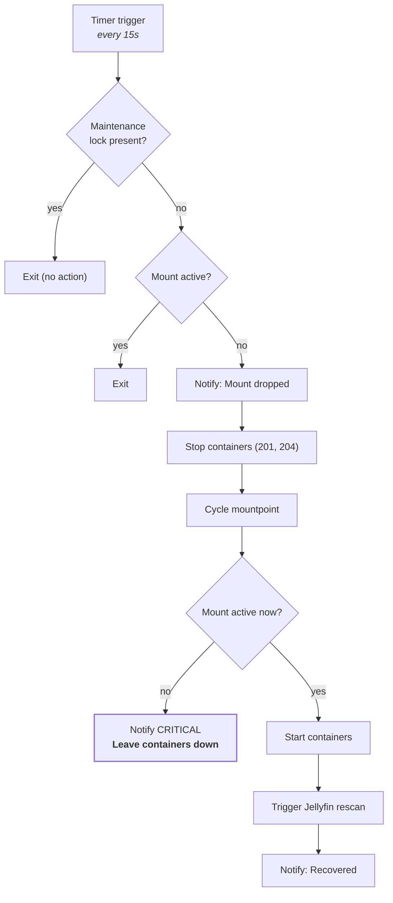

# 9 — Storage Watchdog

Configure automated detection, container fail-safe shutdown, remount cycling, and recovery alerting when the shared media filesystem drops.

---

## Failure Mode and Recovery Workflow

If the shared media mount drops while container processes are running, writes fall through to the underlying host root filesystem, rapidly filling the boot disk. The storage watchdog monitors mount integrity every 15 seconds, terminates container I/O, safely cycles the mount, and triggers alerts.



Key operational design choices:
- **15-second polling interval:** Uses non-blocking `mountpoint -q` checks wrapped with `flock` to prevent concurrency overlap.
- **Fail-safe shutdown:** If remounting fails, containers remain stopped to protect the host root filesystem from data corruption or exhaustion.

---

## Deploy

**1. Clone the repo to the host.** The scripts and systemd units expect
`/opt/homelab`:

```bash
git clone <your-fork-of-this-repo> /opt/homelab
```

**2. Create the environment file.** This is the one place credentials live, and
[chapter 10](10-discord-agent.md) adds to it:

```bash
install -d -m 0750 /etc/homelab
install -m 0600 /opt/homelab/scripts/homelab.env.example /etc/homelab/homelab.env
nano /etc/homelab/homelab.env
```

Fill in what the watchdog needs:

```bash
MEDIA_ROOT=/mnt/media
WATCHDOG_CT_IDS=201 204
MEDIA_SERVER_IP=192.168.1.11
JELLYFIN_API_KEY=<from chapter 4>
NTFY_BASE_URL=https://ntfy.sh
NTFY_TOPIC=<from chapter 8>
```

Confirm the permissions took — this file holds every credential in the build:

```bash
ls -l /etc/homelab/homelab.env      # -rw------- root root
```

**3. Install the units:**

```bash
install -m 0644 /opt/homelab/config/templates/systemd/storage-watchdog.service /etc/systemd/system/
install -m 0644 /opt/homelab/config/templates/systemd/storage-watchdog.timer   /etc/systemd/system/
chmod +x /opt/homelab/scripts/check_storage.sh

systemctl daemon-reload
systemctl enable --now storage-watchdog.timer
```

**4. Confirm it is armed:**

```bash
systemctl status storage-watchdog.timer      # Active: active (waiting)
systemctl list-timers storage-watchdog.timer # next firing within 15s
```

---

## Verification

Validate automatic recovery:

1. Simulate an unmount event:

```bash
journalctl -u storage-watchdog.service -f &
umount -l /mnt/media
```

Within 15 seconds, the watchdog should detect the drop, stop containers, cycle the mount, restart containers, and issue a recovery alert.

2. Verify operational state:

```bash
mountpoint -q /mnt/media && echo "Storage mounted"
pct status 201; pct status 204
```

3. Verify maintenance override:

```bash
touch /tmp/maintenance.lock
umount -l /mnt/media
sleep 30

mountpoint -q /mnt/media \
  && echo "Watchdog triggered unexpectedly" \
  || echo "Watchdog held by maintenance lock"

mount /mnt/media
rm -f /tmp/maintenance.lock
```

> **Warning:** Ensure `/tmp/maintenance.lock` is removed after testing to re-arm the watchdog.

---

## Configuration Reference

Variables are read from `/etc/homelab/homelab.env`:

| Variable | Purpose | Default |
| :--- | :--- | :--- |
| `MEDIA_ROOT` | Mount point to watch | `/mnt/media` |
| `WATCHDOG_CT_IDS` | Containers to stop and restart | `201 204` |
| `MEDIA_SERVER_IP` | Media server to ask for a rescan | *unset (rescan skipped)* |
| `JELLYFIN_API_KEY` | Key for the rescan call | *unset (rescan skipped)* |
| `NTFY_BASE_URL` / `NTFY_TOPIC` | Notifications | *unset (alerts skipped)* |
| `MAINTENANCE_LOCK` | Lockfile suppressing all action | `/tmp/maintenance.lock` |
| `STOP_TIMEOUT` | Seconds to wait for a container to stop | `30` |

See [admin_storage_watchdog.md](../admin_storage_watchdog.md).

---

## Troubleshooting

**Timer active but no recovery on unmount:** Inspect service logs: `journalctl -u storage-watchdog.service -n 50`. Confirm `/tmp/maintenance.lock` is not present.

**Mount recovered but Jellyfin rescan skipped:** Verify `MEDIA_SERVER_IP` and `JELLYFIN_API_KEY` in `/etc/homelab/homelab.env`.

**No notification alerts:** Check `NTFY_TOPIC` configuration and verify host outbound network egress.

**Containers remain stopped:** The remount attempt failed. Inspect kernel logs: `dmesg -T | tail -50`.

---

**Next:** [10 — Discord agent](10-discord-agent.md)
